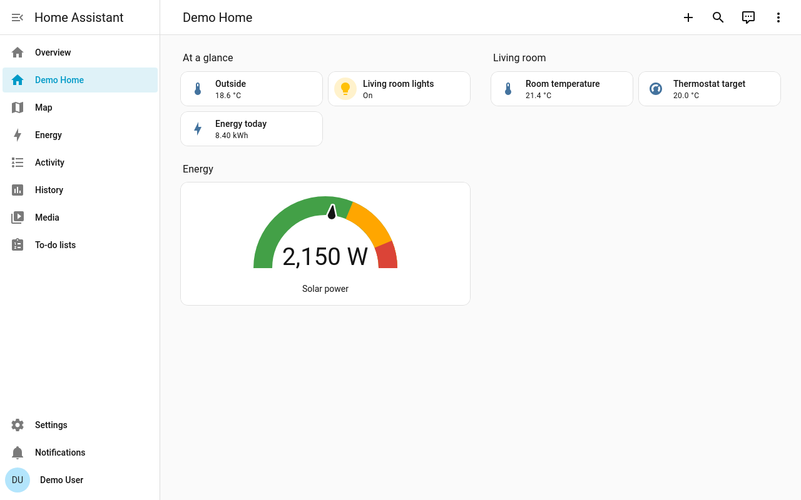

# WPE Screenshot Engine

<p align="center">
  
</p>

<p align="center">
  Headless WebKit screenshots for Home Assistant dashboards.
</p>

<p align="center">
  
  
</p>

<p align="center">
  <a href="https://my.home-assistant.io/redirect/supervisor_add_addon_repository/?repository_url=https%3A%2F%2Fgithub.com%2FNischay-Pro%2Fha-wpe-screenshot-engine">
    
  </a>
</p>

By default, WPE Screenshot Engine renders a requested Home Assistant dashboard route as a 1280 × 800 PNG. Its HTTP API also supports custom viewport sizes and other image formats. It is designed for [Home Assistant MCP](https://github.com/homeassistant-ai/ha-mcp) and other screenshot clients.

## Preview

These screenshots were captured by WPE Screenshot Engine from a disposable Home Assistant instance configured with fictional demo entities and built-in Sections, Tile, and Gauge cards. No screenshots or data from a personal Home Assistant instance are used. The matching Lovelace dashboard and demo entity definitions are in [`tests/fixtures`](tests/fixtures).

<p align="center">
  
</p>

Desktop: [dark](screenshots/mock-lovelace-desktop-dark.png) · [125% zoom](screenshots/mock-lovelace-desktop-zoom-125.png)

Tablet: [landscape light](screenshots/mock-lovelace-tablet-light.png) · [landscape dark](screenshots/mock-lovelace-tablet-dark.png) · [portrait light](screenshots/mock-lovelace-tablet-portrait-light.png)

Mobile: [portrait light](screenshots/mock-lovelace-mobile-light.png) · [portrait dark](screenshots/mock-lovelace-mobile-dark.png) · [landscape](screenshots/mock-lovelace-mobile-landscape-light.png)

Internal page: [Home Assistant Settings](screenshots/mock-home-assistant-settings-light.png)

Dashboard source: [Lovelace YAML](tests/fixtures/mock_lovelace_dashboard.yaml) · [demo entity definitions](tests/fixtures/mock_lovelace_entities.yaml)

## Features

- Renders dashboards with headless WPE WebKit.
- Waits for the requested dashboard to load before returning a screenshot. An optional text check applies only to its configured readiness route.
- Reuses the loaded page between captures to reduce rendering time.
- Supports `amd64` and `arm64` Home Assistant systems with prebuilt images.
- Accepts safe relative paths for dashboards and views on the configured Home Assistant origin.

## Installation

Requires Home Assistant OS or a Supervised installation with the Apps feature.

1. Select **Add repository** above. To add it manually, go to **Settings → Apps → Install app → ⋮ → Repositories** and enter:

   `https://github.com/Nischay-Pro/ha-wpe-screenshot-engine`

2. Install **WPE Screenshot Engine**.
3. Open its **Configuration** tab and enter the required settings.
4. Save the configuration and start the app.

Home Assistant downloads the image for your system architecture when you install or update the app.

## Configuration

The Home Assistant access token is required. The app configuration form masks the token field.

| Setting | Description | Default |
| --- | --- | --- |
| Home Assistant URL | Base HTTP or HTTPS URL reachable from the app, without a path. The default internal hostname is correct for Supervisor apps. | `http://homeassistant:8123` |
| Home Assistant CA certificate | Optional path to a private CA certificate under the Home Assistant `/ssl` directory. Leave blank for public or system-trusted certificates. | Blank |
| Home Assistant access token | Long-lived token for a dedicated, non-admin Home Assistant user. | Required |
| Readiness check route | Lovelace route used to check that the renderer is ready. Readiness text, if set, is checked only on this route. This does not restrict routes the screenshot client can request. | `lovelace/energy` |
| Readiness text | Optional visible text required on the readiness check route. Leave blank to disable the repeated text scan; other requested routes skip it. | Blank |
| Render deadline | Maximum time allowed for one capture, from 1 to 300 seconds. The MCP request timeout must be longer than this limit. | `55` seconds |
| Page reuse idle interval | How long to keep the dashboard loaded between captures. Set to `0` to reload for every request. | `300` seconds |
| WebKit memory target | WebKit process memory pressure target, from 512 to 3072 MiB. | `512` MiB |

Create the access token from the dedicated user's Home Assistant profile. Give that user access only to the dashboards it needs to view. The token is stored in the app configuration and passed to the renderer through a private temporary file.

For HTTPS using a private CA, place a PEM certificate in Home Assistant's `/ssl` directory and set **Home Assistant CA certificate** to its path, such as `/ssl/home-assistant-ca.crt`. The certificate is added to the app's trust store at startup. Direct Docker deployments can mount the certificate and set `HA_CA_CERT_FILE` to its container path under `/ssl`.

## Connect Home Assistant MCP

1. Enable dashboard screenshots in Home Assistant MCP.
2. Open **WPE Screenshot Engine → Info → Network** and note its published host port. The default mapping is `19433` on the Home Assistant host to `8080` inside the app.
3. Set the engine URL explicitly in Home Assistant MCP's **Server Settings → Advanced → Operations**. The URL setting is applied immediately. MCP's Supervisor auto-discovery currently looks for the Puppet app, so it will not discover WPE Screenshot Engine automatically.

   Enter `http://<home-assistant-host>:<published-port>`. For example, `http://192.168.1.2:19433`; replace `192.168.1.2` with your Home Assistant host's address.

Use the app's internal hostname with port `8080` only when the MCP process is on a network that can resolve and reach that hostname. Otherwise, use the Home Assistant host address and published port above. Do not use `localhost` unless MCP and the screenshot engine run in the same network namespace; there it points to MCP itself. If port `19433` is already in use, change the published port in the app's **Network** settings and update the MCP URL to match.

The screenshot client selects the dashboard path on each request. The app's readiness route and text are not an allowlist.

For a Docker-based MCP installation, set `HAMCP_DASHBOARD_SCREENSHOT_ENGINE_URL` to the same reachable URL in the MCP container's environment, then restart that container. Follow the [Home Assistant MCP screenshot guide](https://github.com/homeassistant-ai/ha-mcp/blob/master/docs/beta.md) to enable its screenshot feature.

## HTTP API

The API accepts `GET` requests. The request path selects the Home Assistant route to capture. For example:

```text
GET http://<app-hostname>:8080/lovelace/energy?viewport=1280x800&zoom=1.0&wait=2500&format=png
```

The API accepts the parameters sent by Home Assistant MCP:

| Parameter | Supported value | Default |
| --- | --- | --- |
| `viewport` | Width and height from 64 to 4096 px, or `WIDTHxauto`. Auto-height captures the full document up to 4000 px. | `1280x800` |
| `zoom` | `0.1` to `5.0` | `1.0` |
| `wait` | `0` to `30000` milliseconds | `2500` |
| `format` | `png`, `jpeg`, `webp`, or `bmp` | `png` |
| `theme` | Home Assistant theme name. | None |
| `dark` | Bare `dark`, `true`, `1`, or `yes` requests dark mode; `false`, `0`, or `no` requests light mode. When omitted, Home Assistant's current setting is preserved. | Unchanged |
| `lang` | Home Assistant language code | None |

The endpoint returns the requested image MIME type. `viewport=1280xauto` is the full-page form used by Home Assistant MCP; very tall pages are clipped at 4000 px, with `X-WPE-Screenshot-Truncated: true` on the response. Full-page capture returns 422 for vertically scrolling inner containers. Fixed and sticky elements are laid out as ordinary page content during a full-page capture. The raw capture buffer is limited to 60 MiB, so the largest width and height values cannot always be combined. Encoded images are limited to 20 MiB. Use any safe relative path on the configured Home Assistant origin in place of `lovelace/energy`. `GET /healthz` checks whether the service is running; `GET /readyz` checks whether the renderer is ready. Theme, dark-mode, and language overrides apply to the returned image without changing saved Home Assistant user preferences. A full client disconnect cancels its capture; a request-side TCP half-close can still receive the response.

## Network and security

The API listens on port `8080` inside the Home Assistant app network. Host port `19433` is mapped to it by default and can be changed in the app's **Network** settings. The screenshot API listens on all container interfaces and has no inbound authentication or route allowlist. Anyone who can reach it can request screenshots of any safe route available to the token's Home Assistant user, including account or configuration pages. The configured readiness route is not an access restriction. Keep the mapped port on a trusted network and use a dedicated, low-privilege Home Assistant user for the token.

The renderer validates screenshot paths and blocks cross-origin main-frame and frame navigations before they begin, then resets the view after a blocked redirect. A transient `about:blank` navigation is ignored. The renderer does not filter ordinary external subresource requests made by a dashboard. HTTPS certificates must be trusted by the system CA store or by the optional private CA certificate configured above.

Nested Linux namespaces are restricted inside Home Assistant apps, which prevents WebKit's Bubblewrap process sandbox from starting. The app disables that inner sandbox so rendering works in the app container; Supervisor's outer container restrictions remain enabled, and the renderer runs as UID `10001` with no Linux capabilities. This reduces browser-process isolation, so use trusted dashboards. The app removes its temporary token file after reading it and before starting WebKit. WebKit's [upstream sandbox override](https://bugs.webkit.org/show_bug.cgi?id=250232) is deliberately named to flag this security tradeoff.

## Troubleshooting

- **First start reports that no token is available:** set the Home Assistant access token in the app's **Configuration** before starting. Startup waits briefly for Supervisor options to appear and reports a direct configuration error if the token is still missing.
- **Login page or authorization error:** check the Home Assistant URL and token, and confirm the token's user can open the requested dashboard.
- **Dashboard never becomes ready:** the app waits for the Home Assistant panel to load, or for a non-panel page to finish loading. If readiness text is configured, it is checked only on the configured readiness route.
- **MCP cannot connect:** check the URL in the MCP configuration. Use port `8080` only over the shared app network; outside it, use the Home Assistant host address and mapped port (default `19433`).

## Development

Build the app image and run the HTTP and security regression tests on Ubuntu. Install Python 3, Docker with its daemon running, `pre-commit`, `cppcheck`, `shellcheck`, and `yamllint` first. The Home Assistant app configuration hook also uses Docker.

```sh
docker build --tag wpe-screenshot-engine:dev ./wpe_screenshot_engine
python3 -m unittest discover -s tests -v
pre-commit install
pre-commit run --all-files
```

GitHub Actions builds and publishes installable images for `amd64` and `arm64` when a GitHub release is published.

See the [app changelog](wpe_screenshot_engine/CHANGELOG.md) for release history. The [.env.example](.env.example) file documents environment variables for direct Docker deployments; the Home Assistant app reads its settings from its Configuration page.
